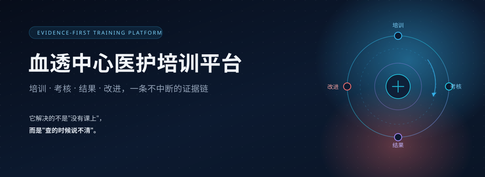
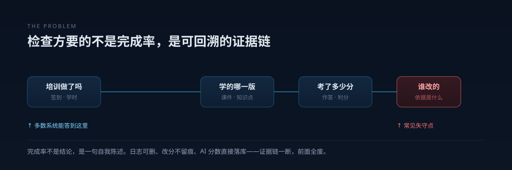
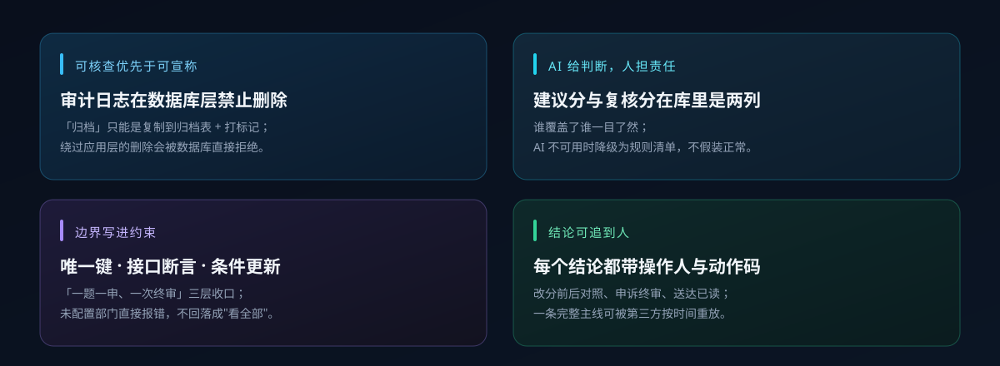
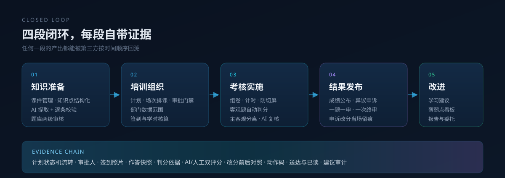
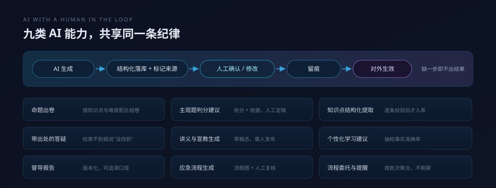
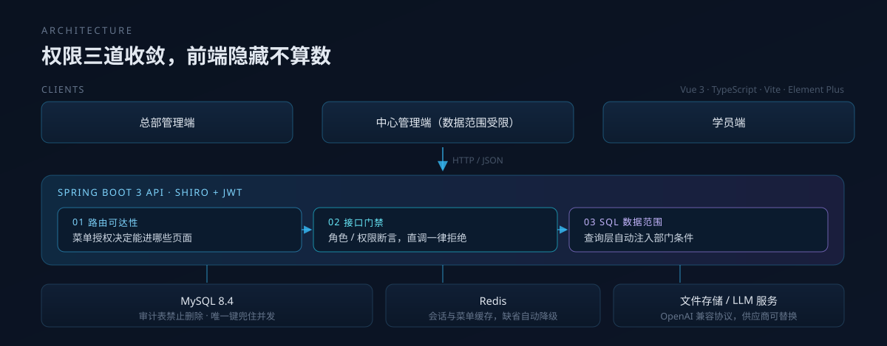
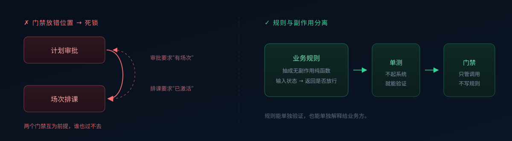
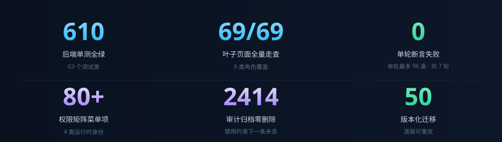

  
    
  

 

## 市面上的培训系统能回答"这次培训做了吗"。 这个平台回答的是"这个分数后来被谁改过，依据是什么"。

面向血液透析中心医护人员的培训与考核一体化平台。它解决的不是"没有课上"，而是<strong>查的时候说不清</strong>。

> **本仓库是项目说明页，不含任何源代码。** 完整实现保存在私有开发仓库中，此处仅公开展示项目要解决的问题、产品设计思路、能力范围与验证结果。

---

## 一分钟看懂

- **它做什么** — 把"培训 → 考核 → 结果 → 改进"四段串成一条闭环，覆盖课件、题库、组卷、考试、判分、成绩发布、申诉、学习建议全流程。
- **凭什么可信** — 审计日志在数据库层禁止删除；AI 只给建议、人担责任，两个分数在库里分列存储；权限边界落在接口断言与 SQL 数据范围，不依赖前端隐藏。
- **现在到哪一步** — V1.0 内部可演示。核心闭环通过自动化验收，610 个后端单测全绿，69 个页面全量走查。**尚未部署于任何医疗机构**，不宣称生产可用。

---

## 01 · 问题：证据链断在最后一环

血透是强合规场景。等级评审、医保飞检、院感检查反复问的是同一组问题：这次培训做了吗、谁参加了、学的什么版本的材料、考了多少分、谁判的、**这个分数后来被谁改过、依据是什么**。

市面上的培训系统大多能回答前三问：有课件、有通知、有完成率。但完成率不是一个可核查的结论，它是一句自我陈述。检查方要的是能逐条回溯的证据链，而多数系统在"谁改过这个分"这一层就已经失守——日志可以被删、改分不留痕、AI 给出的分数直接落库。

这个项目的全部设计取舍，都从"证据链不能断"这个约束出发。

---

## 02 · 四条硬规矩

这四条不写在文档里供人参观，而是固化成系统的硬约束：

- **审计日志在数据库层禁删。** "归档"只能是"复制到归档表 + 打标记"，一条都不能少；任何绕过应用层的删除会被数据库直接拒绝（实测归档 2414 条，一条未丢）。分数、结论、审批链都带操作人、时间、动作码。
- **AI 的建议分与人工复核分是两列。** 谁覆盖了谁一目了然。任何**对人产生后果**的结论都必须有人按下确认键，且确认或覆盖要留痕。AI 不可用时系统降级为规则清单，而不是假装正常。
- **边界写进约束，不只写进约定。** 权限、数据范围、可删除性、可申诉次数，都以数据库唯一键、接口断言、状态机条件更新的形式存在。学员"一题一申、一次终审"是三层收口：前端不给入口、接口查任意状态一律拒绝、唯一键兜住并发。**只挡前端不算数**——接口可以被直调。
- **未配置数据范围时直接报错。** 中心级管理者的可见范围来自部门关系，没有部门就没有边界，系统不会静默回落成"看全部"。

---

## 03 · 一条不中断的闭环

平台按四段组织，每段都有对应的证据留痕：

| 环节 | 能力 | 留下的证据 |
|---|---|---|
| 知识准备 | 课件、知识点结构化、AI 提取校验、题库两级审核 | 知识点来源、审核人、提案采纳记录 |
| 培训组织 | 计划、排课、审批门禁、部门数据范围、签到学时 | 状态机流转、审批人、签到照片、学时依据 |
| 考核实施 | 组卷、计时、防切屏、自动判分、主观题 AI 建议 | 作答快照、判分依据、双评分、异常标记 |
| 结果发布 | 成绩公布、异议申诉、当场改分、一次终审 | 改分前后对照、动作码、送达与已读 |
| 改进闭环 | 学习建议、薄弱点看板、督导报告、流程委托 | 建议审计、报告版本、委托撤销记录 |

一条端到端主线是：**建课件 → 结构化知识点 → 组卷 → 发布计划 → 学员考试 → AI 建议判分 + 人工复核 → 发布成绩 → 申诉处理 → 学习建议回流**。每一步的产出一并写入证据链，可被第三方按时间顺序回溯。

---

## 04 · AI 的位置：给判断，但不担责任

平台有九类 AI 能力，但它们共享同一条纪律：**AI 生成 → 结构化落库（标记来源）→ 人工确认/修改 → 留痕 → 才对外生效。**

几个具体的设计选择：

- **答疑不做知识库幻觉兜底。** 回答必须带出处；检索不到依据时明说"没找到"，并记录"无依据"次数进入质量看板，而不是生成一段听起来合理的话。
- **敏感通知必须二次确认。** 涉及不合格、补考这类字眼，AI 只负责起草，发送前必须有人确认。敏感词判定由代码完成，不交给模型自我判断。
- **建议有"事实准确率"指标。** 学习建议的评估不只看"有没有收到"，还抽检它对你这段失分的判断是否属实。
- **成本可核算。** 每次调用记录 token 与单价快照，看板读快照而不是现价——单价改了不能篡改历史成本。

---

## 05 · 架构：前端隐藏只是体验，边界在接口与 SQL 层

**权限三道收敛：** 路由可达性（菜单授权）→ 接口门禁（角色/权限断言）→ SQL 数据范围（查询层自动注入部门条件）。前端的隐藏只是体验，不是边界。中心级管理者的部门范围在"计划 / 场次 / 台账"三处口径一致。

技术选型：

- **后端** — Java 17 · Spring Boot 3.2 · MyBatis-Plus · Apache Shiro · JWT · Spring 定时任务
- **前端** — Vue 3 · TypeScript · Vite · Element Plus
- **存储** — MySQL 8.4 · Redis（无 Redis 时自动降级为内存实现）
- **文档导出** — Apache POI（Word/Excel）· OpenPDF（含中文内嵌字体）
- **AI** — OpenAI 兼容协议，供应商可替换；凭据由运行时环境提供

规模：后端约 580 个 Java 文件 / 5 万余行，前端约 130 个组件 / 3.5 万行，50 个版本化数据库迁移，23 个业务模块，四类运行时角色的权限矩阵覆盖 80 余项菜单。

---

## 06 · 工程硬功夫

几个真正花时间、也最能说明工程判断的地方。

**门禁不能造成死锁。** 计划审批要求"有考试或场次"，但场次属于审批**前**的动作，学员分配又要求计划已激活。若门禁放错位置，会出现"不通过审批不能排场次、不排场次不能通过审批"的死锁，或第二个"不能分学员 / 不能过审"的循环。业务规则因此被抽成**无副作用的纯函数**并配单测，规则与副作用分离，能单独验证，也能单独解释给业务方。

**归档要在数据库禁令下完成。** 审计日志表上设有禁删约束，第一次实现"复制 → 校验 → 删除"直接报错。改成"复制 + 标记 + 三重校验（标记数 = 应归档数 = 归档表可查数），不一致整体回滚"，实际归档 2414 条，一条未删。

**并发与幂等。** 交卷幂等；状态机用条件更新（带旧状态作为前置条件）而非先查后改；成绩记录表加唯一键并在冲突时转入更新路径。唯一键冲突统一转成人类可读的"该记录已存在"提示，而不是抛 500。

**迁移是手册，不是魔法。** 没有使用自动迁移框架，迁移脚本是版本化执行手册，逐版可重放。排序规则不一致会让跨表关联直接报错，这类问题只能在迁移里显式对齐——它不会在开发环境暴露，只会在数据量变大后暴露。

---

## 07 · 质量与验证

| 维度 | 当前 |
|---|---|
| 单测 | 610 个用例 / 63 个测试类，全绿 |
| 类型检查 | 前端全量通过，无 `any` 逃逸 |
| 自动化验收 | 7 轮，单轮最大 96 条断言、0 FAIL |
| 人工走查 | 6 类角色 69 个叶子页面 69/69，关键流程实跑留图 |
| 缺陷台账 | 登记 81 条，仅 1 条 OPEN 并注明原因 |
| 数据迁移 | 50 个版本，逐版可重放 |

验证原则只有一条：**自动化通过不等于业务验收通过**。所以每一轮都分两层记录——脚本断言跑出什么，人在浏览器里实际看到什么。

曾经出现过"接口全绿但 UI 建题全量被拒"的情况：前端漏掉一个必填确认框，而测试脚本直接调接口绕过了它。这条教训写进了验证手册：**API 造数会绕过前端确认链，API 全绿 ≠ UI 可用**。

---

## 08 · 发布状态

当前版本定位为 **V1.0 内部可演示版本**，不宣称生产可用。

| 维度 | 状态 |
|---|---|
| 业务闭环 | 已完成并通过自动化验收 |
| AI 能力 | 九类全部完成，人工确认链完整 |
| 合规基础 | 权限模型、审计留痕、隐私评估、等保初稿 |
| 真实部署 | **未发生**，无采购方、无生产数据 |
| 认证与 SLA | **不在范围内** |

已知限制（不隐藏）：

- 知识点图谱的节点关系尚无写入入口，薄弱点看板目前只有章节口径；
- 课件状态字段名不副实，真正的闸门在培训计划状态机；
- 登录页在会话过期时存在一次误提示，已定位未修（修复涉及配置接口匿名化，属安全面变更）；
- 插件管理页已下线，上传配置改由环境变量与数据库配置控制。

---

## 09 · 角色与使用路径

平台不做"注册即用"，四类身份的能力边界由组织关系决定。

- **系统管理员** — 初始化中心与科室、创建账号并分配角色、维护菜单与字典。权限变更需二次确认并留痕；角色权限矩阵不开放给界面随意修改，避免线上事故。
- **总部培训管理者** — 制定年度计划 → 上传课件并做知识点结构化 → 组卷并走两级审核 → 发布计划并分配学员 → 审核成绩发布 → 查看督导报告与薄弱项看板。
- **中心级管理者** — 接收本中心计划 → 排定场次与考勤 → 追踪本中心完成情况 → 处理本中心的忘记密码申请。跨中心数据在接口层即被拒绝，不依赖前端隐藏。
- **学员** — 查看本人待办 → 学习课件 → 参加考试（计时、防切屏）→ 查看已发布成绩 → 对存疑题目提交一次异议（一题一申，一次终审）→ 接收学习建议与站内信。

中心级不是缩小版管理员——她不能跨中心、不能改计划，但必须能管本中心的场次与考勤。

如需了解实现细节或安排演示，可通过本仓库 Issues 联系。

---

## 10 · 公开边界

本仓库只承载项目说明，用于展示问题定义、产品设计与验证结果：

- **不含任何源代码**，完整实现位于私有开发仓库，不在本仓库公开；
- 不含任何真实 API Key、数据库密码、JWT 密钥或私钥；
- 不含真实培训资料、业务数据库导出、运行日志与个人机器路径；
- 不含真实机构名称与人员信息，文中数据均为构造或脱敏数据；
- 演示仅供功能体验，请勿输入真实患者或临床业务数据；
- 第 7、8 节的数据取自最近一轮内部回归，可能滞后于内部主干；
- 项目来源为真实业务需求，但**未部署于任何医疗机构**，不构成医疗合规结论。

发现本仓库存在疑似凭据或身份信息泄露时，请通过 Issues 告知，我会立即核查并处理。

---

## License

MIT。
